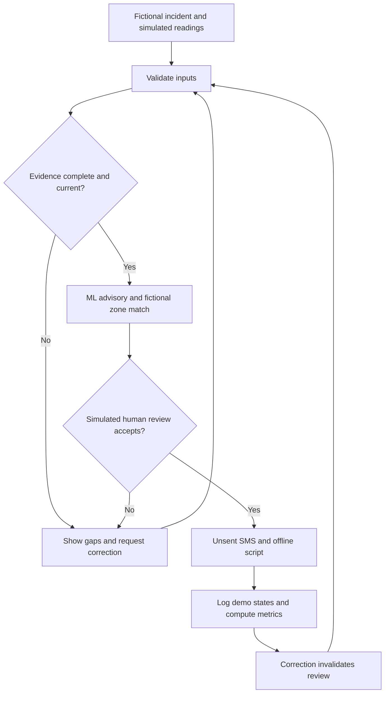
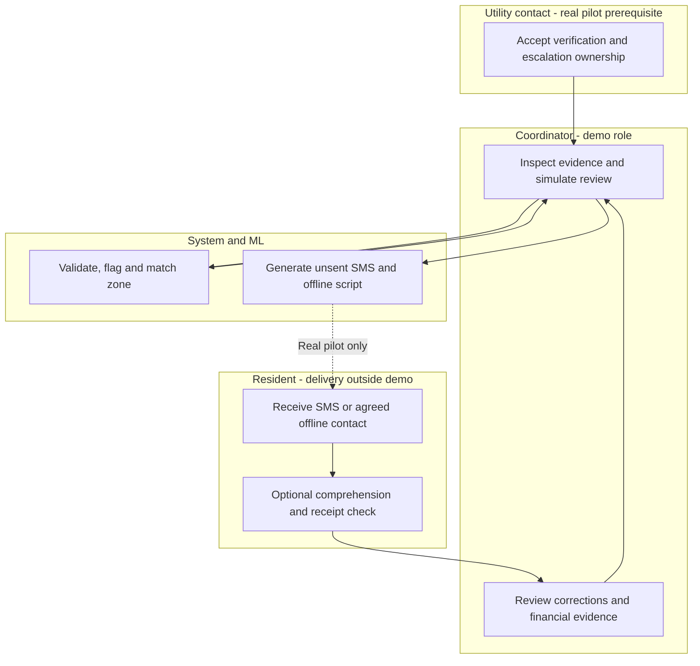

# Agua a Tiempo MX — Packet Before Code
Valeria Karam Galland | Money | Week 11
Planning date: October 21, 2026

## Problem in my words
Households affected by water interruptions lack reliable notices, clear
responsibility and timely updates. Residents should not pay another fee
to receive basic information about a service they already fund.

My household experience is approximately four street-wide interruptions
per year, insufficient stored water and a reported MXN 3,000 bimonthly
bill. This is one household's experience, not a population estimate.

## Exact user
Primary user: a pilot coordinator reviewing utility-sourced notices,
communication quality and pilot costs.
Beneficiaries: residents, including people without smartphones or storage.
Residents do not need this dashboard to receive basic notices.

## Declared slice
Incident-notice review page, SMS preview and pilot cost/payment scorecard.
Honor all six Blueprint conditions, particularly truth, timeliness and
evidence before expansion.

## Success before the module closes
A public demo lets a reviewer load a fictional incident, identify missing
or stale evidence, inspect an ML advisory, simulate human review, generate
an unsent SMS preview and inspect reproducible financial calculations.
Document an actual mechanical bug, fix it and redeploy.
Complete a fresh-chat persona test, fix the worst confusion and retest.

## Image-generated mockup
The AI-generated interface concept is included in PACKET_Valeria_Week11.pdf
in this directory. It is a concept, not evidence of working software.
The interface uses Spanish; project documentation uses English.

## Benchmark
Selected leading benchmark: PUB Singapore's Smart Water Meter and
MySmartWaterMeter provide consumption visibility and suspected-leak alerts.
This is a relevant reference, not a proven universal winner.
Our localization: Spanish, human-reviewed supply-incident notices,
SMS/offline access and utility-funded pilot accountability without
requiring household hardware or charging residents.

Sources:
- https://www.pub.gov.sg/-/media/PUB/PDF/swm/How_Smart_Water_Meter_Works.pdf
- https://eservices.pub.gov.sg/helpandfeedback/report
- Team Blueprint supplied for Week 11.

## Three-year light charter
If this slice works, Agua a Tiempo MX becomes a utility-funded preparation
and accountability service connecting private reserve records with verified
incident updates.
It integrates approved utility sources, optional sensors and consented
aggregate evaluation while retaining SMS and offline access.
Expansion depends on real-event evidence, operational ownership and full
costs rather than invented savings or restoration promises.

## Scope cut
No real SMS delivery, payment collection, production utility integration,
physical hardware, repair service, pooled repair coverage or household map.
No predictions of water quality, incident causes or restoration times.
No real names, phone numbers, addresses or household readings.
Only fictional fixtures and in-memory edits; reload resets changes.

## Blueprint conditions
1. No resident fee or mandatory app for basic notices. Include an SMS
   preview and offline-contact script. No-phone, no-storage and missing
   reading cases cannot lose access.
2. Label simulated, manual, stale and uncertain information. Only an
   authorized human may confirm a real official event. Demo role review
   is explicitly simulated and creates no real authorization.
3. No field spending before a utility contact accepts verification,
   correction and escalation responsibilities. No repair coverage.
4. Target 12-hour advance notice for scheduled cuts. Separate unexpected
   failures. Track source input, review, dispatch, receipt, corrections
   and next update without claiming delivery.
5. Private by default, minimum data, consented aggregation only.
   No sale, household map, penalties or denial based on readings.
6. Track real events, false alarms, comprehension, preparation,
   excluded households and full costs. Report denominators.
   No real event means inconclusive; no invented savings.

## Architecture and Dragon Stack
| Layer | Implementation |
| --- | --- |
| Interface | HTML, CSS, JavaScript; responsive Spanish interface |
| Hosting | GitHub and Vercel; free-tier deployment |
| IoT/sensing | Timestamped simulated reserve feed, clearly labeled |
| ML | Actual small logistic-regression classifier trained on synthetic examples in JavaScript |
| ML evaluation | Fixed-seed train/held-out split; precision, recall and error counts |
| ML authority | Advisory only; never confirms an event or controls payment |
| Geodata | Local GeoJSON with fictional zones and point-in-polygon matching |
| Data | Fictional fixtures; in-memory state; no personal-data storage |
| Validation | Types, lengths, date consistency, allowlists and numeric bounds |
| Output safety | Render input as text; never inject user HTML |

Synthetic ML evaluation does not establish real-world accuracy.
Deterministic evidence rules always block incomplete notices even if the
model suggests otherwise. Do not call hard-coded rules ML.

## Feature flow

## Actor swimlane

## Financial scorecard
Blueprint design: 100 households, three months, MXN 15,000 cap.
Utility-funded proposal; no buyer validation or resident charge.
Fixed component: 70% = MXN 10,500.
Quality-linked pool: up to 30% = MXN 4,500.
Budget per household for pilot: MXN 150.
Budget per household-month: MXN 50.
These allocations are not resident prices.

Full costs include labor, setup, messaging, offline access and other costs.
Disclose in-kind inputs and donated time.
Remaining budget = 15,000 - full costs.
Required benefit for 10:1 = 10 * full costs.
At the budget cap, required benefit is MXN 150,000.
Missing or unverified benefit means "Not demonstrated."

Quality targets:
- At least 90% of eligible scheduled notices at least 12 hours early.
- At least 80% sampled comprehension.
- At least 70% preparation among households able to prepare.
Show every numerator and denominator.
Zero denominators and absent evidence mean inconclusive.

Proposed demo payout rule, not a Blueprint procurement term:
show the quality pool as eligible for human review only if all three
targets pass with real evidence. Never automatically disburse payment.
Synthetic scenarios illustrate arithmetic but establish no eligibility.

## Security floor
No secrets or paid API required.
No personal-data storage; authentication and database RLS are not
applicable to this fictional in-memory demo.
Any future personal-data storage requires authentication and row-level
access controls before release.
Validate all forms and render text safely.
All seeds are fictional and labeled.
A demo role selector is not authentication.

## Test plan
- Missing source/responsible role/next update blocks ready-state preview.
- Stale source requires review; stale readings never deny basic notices.
- Exactly 12 hours qualifies; 11h59m does not.
- Unexpected events stay outside the scheduled-notice denominator.
- Zero denominators return inconclusive.
- Negative, nonfinite and malformed costs are rejected.
- Over-budget state is visible.
- Changing source or dates invalidates previous review.
- Restoration time stays unknown unless supported.
- HTML-like input renders as text.
- ML cannot override evidence checks.
- Held-out ML evaluation includes error counts.
- Outside-zone coordinates do not silently match a zone.
- No-phone and no-storage cases retain notice access.
- SMS previews never claim an actual send.

## Mechanical pass
Run the plan on deployment 1.
Record an actually observed bug, reproduction steps and expected/actual
behavior. Fix, retest and create deployment 2.
Do not invent a bug or mark planned tests as completed.

## Persona pass
Fresh-chat synthetic resident: 54, reads slowly, uses SMS, distrusts
unfamiliar apps and has limited water storage.
This is a proposed synthetic persona, not an interviewed person.
Present screenshots in order and record every hesitation.
Ask whether the notice is official, whether SMS was sent, when water
returns and what happens without storage.
Fix the worst observed confusion and retest.
Add a coordinator walkthrough for financial calculations.

## Commit and deployment plan
1. Packet, mockup reference, implementation prompt and decisions.
2. Validated incident review and correction state.
3. Simulated sensing, actual ML and fictional geodata.
4. SMS/offline previews and financial scorecard; deployment 1.
5. Actual mechanical bug fix and retest; deployment 2.
6. Persona-driven fix and retest if required.

Every session ends with DECISIONS.md updated, the next first move
recorded, commit and push.

## Submission
Live URL; GitHub link; DEMO_Valeria.mp4; PACKET_Valeria.pdf;
PERSONA_Valeria.pdf; full BUILDCHAT_Valeria.pdf.
Demo: three-minute walkthrough plus 30-second mind-change.
No test, deployment or measured pilot result is claimed at planning time.
